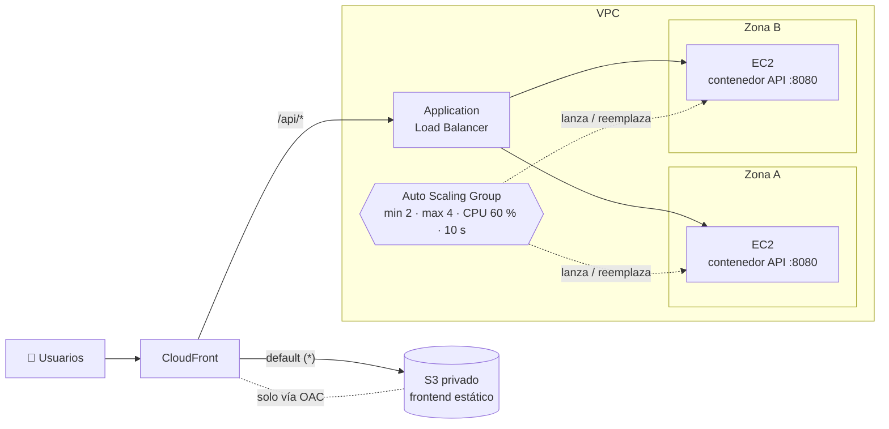

# Grimorios en la Nube

### Arquitectura web escalable y de alta disponibilidad en AWS

Demo educativa para pasar de **una sola instancia** a una arquitectura que **escala sola** y **sobrevive a la caída de un servidor o de una zona de disponibilidad**. Incluye una interfaz interactiva con temática de grimorios y magia elemental: en ella cada panel enseña un concepto y deja verlo en vivo.

| Concepto | Qué se ve en la demo |
|---|---|
| **Application Load Balancer** | Las respuestas se reparten entre instancias de 2 AZ |
| **Health checks** | Una instancia cae, el ALB deja de enviarle tráfico |
| **Auto Scaling Group** | Reemplaza la instancia caída y agrega instancias cuando sube la CPU |
| **S3 privado + OAC** | El frontend vive en un bucket que nadie puede leer directo |
| **CloudFront** | Un solo dominio para frontend y API, y caché en el edge (`Miss` → `Hit`) |

---

## Arquitectura



- El navegador **solo habla con CloudFront**. Todas las llamadas a la API usan rutas relativas (`/api/...`), y como todo sale del mismo dominio **no hace falta CORS**.
- El **ALB solo acepta tráfico de CloudFront** (managed prefix list), y las **instancias solo aceptan tráfico del ALB** (security group).
- Cada EC2 arranca desde una AMI con Docker y la API configurados. No usa user data ni descarga código al escalar.

Las razones detrás de cada decisión están en [docs/arquitectura.md](docs/arquitectura.md).

---

## Contenido del repo

```
├── backend/           API en Python + FastAPI (Dockerfile, tests)
├── frontend/          React + Vite + TypeScript (Dockerfile con nginx para local)
├── infra/             Terraform: toda la infraestructura de AWS
├── scripts/
│   ├── infra-up.sh          despliega todo (Terraform + frontend) con un comando
│   ├── infra-destroy.sh     borra todo (pide confirmación)
│   ├── build-api-ami.sh     construye una AMI desde el backend local mediante una EC2 temporal
│   ├── deploy-frontend.sh   build del frontend + subida a S3 + invalidación
│   ├── demo-check.sh        comprueba reparto y caché desde la terminal
│   └── tf-outputs.sh        funciones para leer los outputs de Terraform
├── docs/
│   ├── arquitectura.md      decisiones de diseño y conceptos
│   └── consola-aws.md       guía paso a paso para crear todo en la consola
├── docker-compose.yml       entorno local
└── .env.example             variables de configuración
```

### API

| Método | Ruta | Descripción |
|---|---|---|
| `GET` | `/health` | Health check del ALB. Liviano: `{"status":"ok"}`, sin dependencias |
| `GET` | `/api/health` | Igual, pero accesible por CloudFront |
| `GET` | `/api/info` | `instance_id`, `availability_zone`, `region`, `hostname`, `version`, `timestamp` |
| `POST` | `/api/spell` | Hechizo aleatorio (nombre, elemento, poder 1-100) y quién lo lanzó |
| `POST` | `/api/stress` | Body `{"seconds": 60}`. Sube la CPU en segundo plano (máx. 300 s). `202` aceptado / `409` ya hay uno activo |
| `POST` | `/api/stress/stop` | Sin body. Cancela el estrés en la instancia que responde; `200` detenido / `202` deteniéndose |
| `GET` | `/api/grimoires` | Lista estática de grimorios de ejemplo |

La metadata de la instancia se lee con **IMDSv2**. Si IMDS no responde en 1 s (en local), se usan valores simulados (`local-xxxx`, `local-az`).

### Variables de entorno

| Variable | Por defecto | Uso |
|---|---|---|
| `APP_VERSION` | `1.0.0` (en EC2: el commit) | Versión que muestra `/api/info` |
| `STRESS_MAX_SECONDS` | `300` | Tope de `/api/stress` |
| `LOG_LEVEL` | `INFO` | `DEBUG` también registra los health checks |

Para desarrollo local, copia `.env.example` como `.env`: Docker Compose lo lee y Git lo ignora. En AWS, la configuración se prepara al construir la AMI; no se copian secretos del `.env` a la imagen.

---

## Requisitos

| Herramienta | Para qué |
|---|---|
| [Docker](https://docs.docker.com/get-docker/) con Compose v2 | Entorno local y build de imágenes |
| [Node.js](https://nodejs.org/) ≥ 22 (recomendado el LTS) | Desarrollar o compilar el frontend (opcional: los scripts pueden compilar dentro de Docker) |
| [Python](https://www.python.org/) ≥ 3.12 | Empaquetar el backend para construir la AMI y ejecutar sus tests |
| [AWS CLI v2](https://docs.aws.amazon.com/cli/latest/userguide/getting-started-install.html) | Credenciales, subir el frontend a S3 e invalidar CloudFront |
| [Terraform](https://developer.hashicorp.com/terraform/install) ≥ 1.10 | Crear y destruir la infraestructura de AWS |
| Git y una terminal bash | En Windows: Git Bash o WSL |

---

## Desarrollo local

### 1. Todo con Docker Compose

```bash
docker compose up --build
```

Abre **http://localhost:8080**. El nginx del frontend hace de "CloudFront": sirve los estáticos y reenvía `/api/*` a la API.

Para ver el reparto de carga como en AWS, levanta **3 réplicas** de la API:

```bash
docker compose up --build --scale api=3
```

En el panel A verás 3 `instance_id` distintos (`local-xxxx`). En local todas las réplicas comparten la AZ `local-az`, así que el color se asigna por instancia. También puedes comprobarlo desde la terminal:

```bash
bash scripts/demo-check.sh http://localhost:8080
```

Prueba a detener una réplica con `docker stop grimorios-api-2`: el tráfico sigue llegando a las demás.

### 2. Tests del backend

```bash
cd backend
python -m venv .venv
source .venv/bin/activate        # Windows (PowerShell): .venv\Scripts\Activate.ps1
pip install -r requirements-dev.txt
pytest
```

Los tests simulan IMDS y no lanzan procesos de estrés reales.

### 3. Frontend con recarga en caliente (opcional)

Con el stack de compose (o la API) corriendo en el puerto 8080:

```bash
cd frontend
npm ci
npm run dev        # http://localhost:5173, reenvía /api a localhost:8080
```

---

## Despliegue en AWS

El código se construye desde tu copia local: no hace falta un repositorio público. Necesitas AWS CLI con credenciales, Terraform, Bash (Git Bash o WSL en Windows), Python 3 y Node o Docker para compilar el frontend.

```bash
cp infra/terraform.tfvars.example infra/terraform.tfvars
# Edita aws_profile y, si corresponde, region/prefix.
bash scripts/infra-up.sh
```

El flujo tiene dos fases porque el constructor necesita red y permisos antes de poder crear la AMI:

1. Terraform prepara subredes, salida a internet, security group, IAM y target group. Esta fase usa targets explícitos; después siempre se ejecuta un apply completo.
2. `build-api-ami.sh` crea una EC2 temporal sin user data. Por Session Manager instala Docker, copia el backend local, construye la imagen y configura el contenedor con `restart=always`, el nombre del ASG y el target group. Comprueba `/health`, detiene el servidor y captura la AMI. La EC2 temporal se elimina al terminar.
3. El ID se guarda en `infra/api-ami.auto.tfvars.json`, ignorado por Git. Terraform aplica el resto de la arquitectura y configura el launch template con esa AMI, **sin user data**.
4. Se publica el frontend en S3 y se invalida CloudFront. El script espera a que las instancias estén sanas.

Construir la AMI y desplegar CloudFront puede tardar varios minutos. Ese trabajo se hace antes de la clase: **al escalar, las EC2 solo arrancan el sistema y el contenedor ya preparados**.

### Scripts que se conservan

| Script | Función |
|---|---|
| `infra-up.sh` | Prepara la base, construye la AMI, aplica toda la infraestructura y publica el frontend |
| `build-api-ami.sh` | Construye solamente la AMI, con la base de infraestructura ya creada |
| `deploy-frontend.sh` | Compila React, sube a S3 e invalida CloudFront |
| `demo-check.sh` | Comprueba reparto de peticiones y caché |
| `infra-destroy.sh` | Borra los recursos de Terraform tras confirmar; las AMI y snapshots requieren limpieza adicional |
| `tf-outputs.sh` | Funciones compartidas para leer URL, perfil y nombres desde Terraform |

Todos se ejecutan desde tu computadora. Ninguno se ejecuta al escalar el ASG.

### Actualizar la API

```bash
# Desde la raíz del repo, con el backend local actualizado:
bash scripts/build-api-ami.sh
terraform -chdir=infra apply
```

El cambio de AMI inicia una renovación progresiva de instancias. Un instance refresh sin construir una AMI nueva reutiliza el código de la imagen anterior.

Opcionalmente, `BASE_AMI_ID=ami-... bash scripts/build-api-ami.sh` permite aprovechar una AMI propia de esta demo como caché. Sin esa variable, construye desde Amazon Linux 2023 limpio. Cada AMI contiene la configuración del grupo y target group de este despliegue.

Para cambiar solo la interfaz: `bash scripts/deploy-frontend.sh`. Para comprobar: `bash scripts/demo-check.sh`. La [guía de consola](docs/consola-aws.md) indica dónde observar cada recurso.

No subas `*.tfvars`, `*.auto.tfvars.json`, estados ni planes de Terraform al repo. Conserva el estado local para poder administrar y destruir este despliegue.

---

## Guion de la demo

Abre la URL de CloudFront en el proyector y, al lado, la consola de AWS.

### Acto 1: Reparto de tráfico (panel A)

- **Qué hacer:** deja correr el panel "¿Qué grimorio respondió?" (consulta `/api/info` cada 2 s).
- **Qué observar:**
  - Los hechizos alternan entre dos elementos: por ejemplo **fuego** para la AZ `…a` y **viento** para la `…b`.
  - Los contadores por instancia y por AZ quedan parejos.
- **Mensaje:** el ALB reparte las peticiones entre instancias sanas de distintas zonas. Si se cae una zona entera, la otra sigue atendiendo.

### Acto 2: Una instancia cae (paneles A y consola)

- **Qué hacer:** en EC2 → Instances, **termina** una de las instancias.
- **Qué observar:**
  1. Puede aparecer alguna petición **en rojo** (502) en el registro de hechizos mientras el ALB detecta la caída.
  2. En el **target group → Targets**, la instancia pasa a `draining` o `unhealthy`, y todo el tráfico va a la instancia que queda.
  3. En el **ASG → Activity**, el ASG detecta que tiene 1 instancia de 2 y **lanza un reemplazo**. A los pocos minutos aparece un `instance_id` nuevo en el panel A.
- **Mensaje:** alta disponibilidad no significa "nunca falla", sino "se recupera sola". Comenta el error típico: si el ASG usa health checks de tipo **EC2** en vez de **ELB**, no reemplaza una instancia cuya *aplicación* murió pero cuya máquina sigue encendida.

### Acto 3: Modo estrés, el ASG escala (panel C)

- Deja 300 s y pulsa varias veces hasta cargar ambas instancias. Una al 100 % y otra al 0 % solo suman un promedio del 50 %.
- La carga termina sola al cumplirse el tiempo. Para terminar antes, pulsa **Parar estrés**: confirma la parada en las instancias activas y avisa si alguna no pudo confirmarse.
- La API publica CPU real cada 10 s; una muestra promedio >60 % activa la ampliación. El ASG agrega una instancia por ajuste, hasta un máximo de 4, con warmup de 60 s.
- El panel consulta `/api/scaling`: muestra “Desplegando…” cuando aumenta la capacidad deseada y “Lista para atender” cuando la EC2 está InService y el ALB la considera healthy.
- Buscamos ver capacidad adicional alrededor de un minuto; AWS no garantiza ese plazo. Primero se detecta la carga y después arranca la EC2 desde la AMI.
- Al terminar, CPU nativa de EC2 <10 % durante cinco minutos permite retirar capacidad hasta el mínimo de 2.

El [contrato de estado y métricas](docs/scaling-api.md) detalla las respuestas. Las métricas y alarmas de alta resolución generan cargos adicionales de CloudWatch.

### Acto 4: El caché de CloudFront (panel D)

- **Qué hacer:** presiona **"Mirar estático"** dos veces y luego **"Mirar /api"**.
- **Qué observar:**
  - El estático pasa de `Miss from cloudfront` a `Hit from cloudfront`, y aparece el encabezado `Age`.
  - La API siempre dice `Miss`, porque `/api/*` tiene el caché deshabilitado.
  - Si ejecutas `deploy-frontend.sh` (que invalida), el estático vuelve a `Miss`.
- **Mensaje:** el contenido estático se sirve desde el edge más cercano, sin tocar S3. Es más rápido para el usuario y le quita carga al origen. Lo dinámico pasa siempre al backend.

---

## Costos y limpieza

**Esta demo no es gratis.** Algunos recursos **se cobran por hora aunque no reciban tráfico**:

- **Application Load Balancer:** se cobra cada hora que exista, más su consumo (LCU).
- **Direcciones IPv4 públicas:** AWS cobra por cada IPv4 pública asignada, y cada instancia tiene una.
- **Instancias EC2:** mínimo 2 corriendo todo el tiempo (hasta 4 si escalan).
- **CloudFront y S3:** con el tráfico de una demo el costo suele ser mínimo, pero no es cero.

Para estimar el costo de tu caso usa la **[AWS Pricing Calculator](https://calculator.aws/)**. Los precios cambian según la región y el momento, así que este repo no los incluye.

**Recomendaciones:**

1. **Antes de empezar**, crea una alerta en **AWS Budgets** (Billing → Budgets → *Create budget* → plantilla *Monthly cost budget*) con un monto bajo y tu email.
2. **Destruye todo al terminar** la clase o el webinar. No lo dejes corriendo "para mañana".

### Cómo destruir todo

**Si desplegaste con Terraform:**

```bash
bash scripts/infra-destroy.sh
```

El script pide escribir `destruir` para confirmar. Las AMI creadas por el constructor y sus snapshots no pertenecen al estado de Terraform: elimínalos también desde EC2 cuando ninguna instancia los necesite. Después ejecuta `terraform destroy`, que vacía el bucket solo (`force_destroy`) y borra todo en el orden correcto. Tarda varios minutos, porque CloudFront primero se deshabilita y luego se borra.

**Si lo creaste en la consola**, el orden importa, porque algunos recursos dependen de otros. La lista completa está en [docs/consola-aws.md → Limpieza](docs/consola-aws.md#limpieza):

1. CloudFront: *Disable* la distribución, esperar a que termine y luego *Delete*.
2. Auto Scaling Group: *Delete* (termina sus instancias).
3. Load balancer y luego el target group.
4. Launch template.
5. Bucket S3: *Empty* y luego *Delete*.
6. Security groups, rol IAM y, por último, la VPC.

Al final revisa **Billing → Bills** y **EC2 → Elastic IPs / Load balancers / Instances** en la región que usaste, para confirmar que no quedó nada.

---

## Troubleshooting

### Los targets quedan `unhealthy` en el target group

- **Security group de las instancias:** debe permitir **TCP 8080** con origen el **security group del ALB**.
- **Puerto del target group:** debe ser **8080** y el health check `/health` con *success codes* `200`.
- **La API está corriendo:** entra por **Session Manager** y ejecuta:
  ```bash
  sudo docker ps
  curl -s localhost:8080/health
  sudo journalctl -u docker -b --no-pager | tail -50
  ```
- **La AMI no tiene la aplicación preparada:** revisa la imagen seleccionada en el launch template. El contenedor debe existir y tener `restart=always`; no hay user data que lo instale. La gracia de salud de 120 s protege el arranque inicial.
- **Las instancias no tienen salida a internet:** necesitan una IPv4 pública (auto-assign en las subredes) y una ruta a un Internet Gateway, para hacer `dnf install`, `git clone` y bajar imágenes de Docker.

### `/api/info` muestra `local-xxxx` y `local-az` en AWS

La API no puede leer IMDS desde el contenedor. En el launch template, revisa que **Metadata version = V2 only** y **Metadata response hop limit = 2**. Con hop limit 1, la respuesta de IMDS no llega al contenedor.

### Error 403 en CloudFront (el sitio no carga)

- **OAC:** el origen S3 debe usar *Origin access control* (no "Public").
- **Política del bucket:** debe permitir `s3:GetObject` al servicio `cloudfront.amazonaws.com` con la condición `AWS:SourceArn` = ARN de **tu** distribución. La consola ofrece copiarla al editar el origen.
- **Default root object:** debe ser `index.html`.
- **El bucket está vacío:** ejecuta `deploy-frontend.sh`.

### Error 504 o 502 en `/api/*`

- **Origen del ALB en CloudFront:** el protocolo debe ser **HTTP only**, puerto 80, con el DNS correcto del ALB.
- **Security group del ALB:** debe permitir el puerto 80 desde la prefix list **`com.amazonaws.global.cloudfront.origin-facing`**.
- **Listener del ALB:** HTTP:80 debe reenviar al target group.
- **Behavior `/api/*`:** debe usar *CachingDisabled*, *AllViewerExceptHostHeader* y permitir `POST`.
- **El ALB tiene targets sanos:** si no tiene ninguno, responde 503 y CloudFront lo propaga.

### El frontend no se actualiza tras desplegar

Pasa el ID de la distribución a `deploy-frontend.sh` para que invalide `/*`, y espera 1 o 2 minutos.

---

## Licencia

[MIT](LICENSE). El arte de la interfaz es original (CSS, SVG y canvas). Este es un proyecto educativo sin afiliación con ninguna serie ni marca.
